# 交流互动系统(1)

> 🎓 **计算机毕业设计 · 交流互动系统(1)**
>
> 本仓库只放**项目介绍 + 运行截图**（截图是站点带水印的原图，存在仓库 `images/` 里）。
>
> 👉 **完整可运行源码 / 数据库脚本 / 部署文档：[点我获取](https://geekcode.top/archives/%E4%BA%A4%E6%B5%81%E4%BA%92%E5%8A%A8%E7%B3%BB%E7%BB%9F-1?utm_source=github)**
>
> 💬 咨询微信：**ir9372**　|　🌐 更多项目：[极客代码 geekcode.top](https://geekcode.top/?utm_source=github)
>
> 📌 项目详情页：<https://geekcode.top/archives/%E4%BA%A4%E6%B5%81%E4%BA%92%E5%8A%A8%E7%B3%BB%E7%BB%9F-1?utm_source=github>

<table><td width="230" align="center"> <b>扫码加微信 ir9372</b></td><td valign="middle">📦 源码 = 项目介绍 + 全部运行截图 + 数据库 + 部署文档 👉 点上方任意截图，直接跳到 <b>极客代码 geekcode.top</b> 详情页</td></table>

---

<h1>交流互动系统(1)</h1>
<h2>项目概述</h2>

本项目名为“交流互动系统”，旨在构建一个集社交分享与线下活动组织于一体的综合性网络平台。系统核心功能涵盖帖子信息的发布与管理、聚会活动的组织报名以及用户间的即时互动。适用人群主要为希望拓展社交圈、参与线下聚会的普通用户，以及负责内容审核与活动管理的后台管理员。技术架构上，系统采用前后端分离模式，后端基于 Spring Boot 框架构建 RESTful API，利用 MyBatis-Plus 实现高效的数据持久化操作，并集成 Apache Shiro 进行安全权限控制；前端采用 Vue.js 框架实现动态交互界面，数据库选用 MySQL 存储业务数据。通过该系统的实施，能够有效解决传统社交平台信息分散、活动组织流程繁琐的问题，为用户提供便捷的线上交流与线下互动体验。

<h2>技术架构</h2>

本系统采用经典的前后端分离架构设计，确保了系统的可维护性、扩展性及用户体验的流畅度。

<strong>1. 后端架构</strong>
后端服务基于 Java 语言开发，核心框架选用 Spring Boot，利用其自动配置和起步依赖特性快速搭建应用骨架。数据访问层采用 MyBatis-Plus 作为 ORM 框架，在保留 MyBatis 灵活 SQL 编写能力的同时，提供了通用的 CRUD 接口和分页插件，显著提升了开发效率。安全认证与授权模块集成 Apache Shiro，实现了细粒度的权限控制和会话管理，保障系统数据安全。通信协议采用 HTTP/HTTPS，通过 Controller 层（如 <code>TiezixinxiController</code>, <code>JuhuixinxiController</code> 等）对外提供标准的 RESTful API 接口。

<strong>2. 前端架构</strong>
前端采用 Vue.js 框架构建单页面应用（SPA），结合 Element UI 或类似组件库实现响应式布局。前台面向普通用户，提供帖子浏览、聚会报名等功能；后台面向管理员，提供数据管理与配置功能。前后端通过 Axios 进行异步数据请求，实现视图模型的双向绑定与动态更新。

<strong>3. 数据库设计要点</strong>
数据库选用 MySQL 关系型数据库。主要实体包括用户表（Yonghu）、帖子信息表（Tiezixinxi）、聚会信息表（Juhuixinxi）、报名信息表（Baomingxinxi）、评论表（Discusstiezixinxi）、收藏表（Storeup）及分类表（Tiezifenlei）。各表之间通过外键关联，例如帖子与分类、聚会与报名记录等，确保数据的一致性与完整性。配置表（Config）用于管理系统参数如轮播图等静态资源信息。

<strong>4. 核心技术选型理由</strong>

<ul>
<li><strong>Spring Boot</strong>: 简化配置，内嵌 Tomcat，适合快速迭代开发。</li>
<li><strong>MyBatis-Plus</strong>: 相比原生 MyBatis 减少大量样板代码，支持 Lambda 表达式查询，提升类型安全性。</li>
<li><strong>Shiro</strong>: 轻量级且强大的安全框架，易于与 Spring 集成，满足基本的身份验证和角色权限需求。</li>
</ul>
<h2>功能模块</h2>

根据源码中的 Controller 列表及截图展示的功能，系统分为前台用户端和后台管理端两大模块。

<h3>前台用户端</h3>

前台界面主要面向注册用户，提供社交互动与活动参与功能：

<ol>
<li><strong>首页与导航</strong></li>
</ol>
<ul>
<li>展示系统最新推荐内容及全局导航菜单（帖子信息、聚会信息）。</li>
<li>包含轮播图展示区域，由后台配置管理。</li>
</ul>
<ol start="2">
<li><strong>用户认证模块</strong></li>
</ol>
<ul>
<li><strong>登录页</strong>：支持用户账号密码登录。</li>
<li><strong>注册页</strong>：新用户填写基本信息完成注册。</li>
</ul>
<ol start="3">
<li><strong>帖子互动模块</strong></li>
</ol>
<ul>
<li><strong>帖子信息列表</strong>：浏览所有公开帖子，支持按分类筛选。</li>
<li><strong>帖子信息详情</strong>：查看帖子具体内容、作者信息及发布时间。</li>
<li><strong>帖子评论</strong>：在详情页下方查看其他用户的评论，并可发表新评论。</li>
<li><strong>帖子分类列表</strong>：查看不同主题的分类入口。</li>
</ul>
<ol start="4">
<li><strong>聚会活动模块</strong></li>
</ol>
<ul>
<li><strong>聚会信息列表</strong>：浏览即将举行的聚会活动概览。</li>
<li><strong>聚会信息详情</strong>：查看聚会时间、地点、人数限制等详细信息。</li>
<li><strong>报名信息列表</strong>：用户查看自己已提交的聚会报名记录。</li>
<li><strong>报名信息详情</strong>：查看特定报名记录的审核状态及详情。</li>
</ul>
<ol start="5">
<li><strong>个人中心模块</strong></li>
</ol>
<ul>
<li><strong>个人中心</strong>：查看和编辑个人基本资料。</li>
<li><strong>我的收藏</strong>：查看用户收藏的帖子或聚会活动列表。</li>
</ul>
<ol start="6">
<li><strong>在线客服模块</strong></li>
</ol>
<ul>
<li><strong>在线客服</strong>：提供用户与平台客服或管理员之间的实时聊天窗口，支持消息发送与接收。</li>
</ul>
<h3>后台管理端</h3>

后台界面面向系统管理员，提供全面的数据管理与系统配置功能：

<ol>
<li><strong>系统管理</strong></li>
</ol>
<ul>
<li><strong>登录页</strong>：管理员专属登录入口。</li>
<li><strong>后台首页</strong>：展示关键数据统计或快捷操作入口。</li>
<li><strong>轮播图管理</strong>：配置前台首页展示的轮播图片资源。</li>
<li><strong>系统配置</strong>：管理网站基础参数设置。</li>
</ul>
<ol start="2">
<li><strong>用户管理</strong></li>
</ol>
<ul>
<li><strong>用户管理</strong>：查看、新增、修改、删除注册用户信息，重置密码等。</li>
</ul>
<ol start="3">
<li><strong>内容管理</strong></li>
</ol>
<ul>
<li><strong>帖子分类管理</strong>：维护帖子的分类标签体系。</li>
<li><strong>帖子信息管理</strong>：审核、发布、编辑或删除用户提交的帖子内容。</li>
<li><strong>帖子评论管理</strong>：查看和管理用户对帖子的评论，支持删除违规评论。</li>
</ul>
<ol start="4">
<li><strong>活动管理</strong></li>
</ol>
<ul>
<li><strong>聚会信息管理</strong>：创建、编辑、上下架聚会活动详情。</li>
<li><strong>报名信息管理</strong>：审核用户的聚会报名申请，处理通过或拒绝操作。</li>
</ul>
<ol start="5">
<li><strong>互动管理</strong></li>
</ol>
<ul>
<li><strong>我的收藏管理</strong>：查看全站用户的收藏记录，便于分析热门内容。</li>
<li><strong>在线客服管理</strong>：管理员在此模块回复用户咨询，查看历史聊天记录。</li>
</ul>
<h2>用户角色与权限</h2>

系统基于 Apache Shiro 框架实现权限控制，主要划分为两种角色：

<strong>1. 普通用户 (User)</strong>

<ul>
<li><strong>权限范围</strong>：仅能访问前台界面。</li>
<li><strong>具体功能</strong>：</li>
<li>注册与登录账户。</li>
<li>浏览帖子和聚会信息。</li>
<li>对帖子进行评论。</li>
<li>报名参加聚会活动。</li>
<li>收藏感兴趣的内容。</li>
<li>使用在线客服进行咨询。</li>
<li>管理个人资料及查看自己的报名和收藏记录。</li>
<li><strong>限制</strong>：无法进入后台管理界面，无权修改或删除他人发布的内容，无权审核报名申请。</li>
</ul>

<strong>2. 管理员 (Admin)</strong>

<ul>
<li><strong>权限范围</strong>：拥有最高权限，可访问后台管理界面及部分前台功能。</li>
<li><strong>具体功能</strong>：</li>
<li>管理所有注册用户的信息。</li>
<li>全权管理帖子分类、帖子内容及评论（增删改查）。</li>
<li>创建和管理聚会活动信息。</li>
<li>审核用户提交的聚会报名申请。</li>
<li>配置系统参数及首页轮播图。</li>
<li>处理在线客服的用户咨询。</li>
<li>查看全站用户的收藏统计数据。</li>
<li><strong>限制</strong>：通常不直接参与前台的社交互动（如发帖、报名），主要职责为内容监管与系统运维。</li>
</ul>
<h2>项目特色与创新点</h2>
<ol>
<li><strong>线上线下联动机制</strong>：系统不仅局限于线上的文字交流（帖子），还深度融合了线下社交场景（聚会活动）。通过“聚会信息发布 -&gt; 用户在线报名 -&gt; 后台审核”的闭环流程，有效解决了陌生人社交中信任成本高、组织难度大痛点，增强了用户的真实互动体验。</li>
<li><strong>多维度的内容互动体系</strong>：构建了“帖子-分类-评论-收藏”四位一体的内容生态。用户可以通过分类精准查找兴趣话题，通过评论区建立观点碰撞，通过收藏夹沉淀有价值信息，极大地提升了平台的用户粘性和内容复用率。</li>
<li><strong>内置即时通讯模块</strong>：集成了在线客服聊天功能（ChatController），使得用户在遇到活动疑问或平台问题时，能够无需跳出当前页面即可获得实时反馈。这一设计提升了服务的响应速度，优化了用户旅程。</li>
<li><strong>基于 Shiro 的安全管控</strong>：相较于传统的简单拦截器，引入 Shiro 框架实现了更规范的会话管理和权限校验，特别是在后台管理敏感数据（如用户隐私、审核权限）时，提供了可靠的安全保障。</li>
<li><strong>模块化与可扩展性</strong>：后端采用标准的 MVC 分层架构，Controller 层清晰划分了业务边界（如 Tiezi, JuHui, BaoMing 等独立控制器），前端路由与组件高度解耦。这种设计使得未来若需增加新功能（如视频帖子、群组聊天），只需添加对应的 Controller 和 Vue 组件，无需重构核心逻辑。</li>
</ol>
<h2>部署环境</h2>

为确保“交流互动系统”正常运行，需准备以下软件及硬件环境：

<strong>1. 开发环境</strong>

<ul>
<li><strong>操作系统</strong>：Windows 10/11, macOS 或 Linux (CentOS/Ubuntu)。</li>
<li><strong>JDK 版本</strong>：Java Development Kit 1.8 (JDK 8) 或以上版本。</li>
<li><strong>构建工具</strong>：Maven 3.6+ (用于依赖管理及项目打包)。</li>
<li><strong>IDE</strong>：IntelliJ IDEA 或 Eclipse (后端开发)，Visual Studio Code 或 WebStorm (前端开发)。</li>
</ul>

<strong>2. 运行环境</strong>

<ul>
<li><strong>服务器中间件</strong>：内置于 Spring Boot 的 Tomcat 容器（生产环境建议使用 Nginx 反向代理 + Standalone Tomcat 或直接 Jar 包运行）。</li>
<li><strong>数据库</strong>：MySQL 5.7 或 MySQL 8.0 Community Server。需初始化相关数据表结构。</li>
<li><strong>Node.js</strong>：v12.0 或更高版本（用于编译前端 Vue 项目）。</li>
<li><strong>浏览器</strong>：Chrome, Firefox, Edge 等现代主流浏览器。</li>
</ul>

<strong>3. 依赖库说明</strong>

<ul>
<li><strong>后端依赖</strong>：spring-boot-starter-web, mybatis-spring-boot-starter, mysql-connector-java, shiro-spring, mybatis-plus, commons-lang3, validation-api 等。</li>
<li><strong>前端依赖</strong>：Vue.js, Axios, Element UI (或其他 UI 框架), Vue Router, Vuex (视具体前端工程而定)。</li>
</ul>

<strong>4. 部署步骤简述</strong>

<ol>
<li>安装 JDK 和 Maven，配置环境变量。</li>
<li>安装 MySQL，创建数据库并导入项目提供的 <code>.sql</code> 脚本文件。</li>
<li>修改后端配置文件 (<code>application.yml</code> 或 <code>properties</code>)，配置数据库连接 URL、用户名和密码。</li>
<li>在后端项目根目录执行 <code>mvn clean package</code> 生成 jar 包，或通过 IDE 直接运行主启动类。</li>
<li>在前端项目根目录执行 <code>npm install</code> 安装依赖，随后执行 <code>npm run build</code> 生成静态资源文件。</li>
<li>将生成的前端静态文件部署至 Nginx 或 Tomcat webapps 目录下，并确保 Nginx 正确代理后端 API 接口地址。</li>
</ol>
<h2>五、技术特性</h2>
<ul>
<li>前后端集成部署，前端资源打包至后端 static 目录</li>
<li>使用 MyBatis-Plus 简化数据访问层开发</li>
<li>集成 Shiro 权限框架实现角色权限控制</li>
</ul>
<h2>六、功能模块截图</h2>
<h3>前台用户端</h3>
<h4>前台首页</h4>

<a href="https://geekcode.top/archives/%E4%BA%A4%E6%B5%81%E4%BA%92%E5%8A%A8%E7%B3%BB%E7%BB%9F-1?utm_source=github" title="查看完整源码">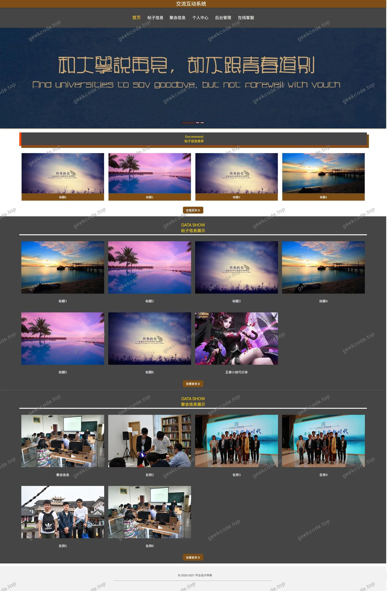</a>

<h4>前台登录页</h4>

<h4>前台注册页</h4>

<a href="https://geekcode.top/archives/%E4%BA%A4%E6%B5%81%E4%BA%92%E5%8A%A8%E7%B3%BB%E7%BB%9F-1?utm_source=github" title="查看完整源码">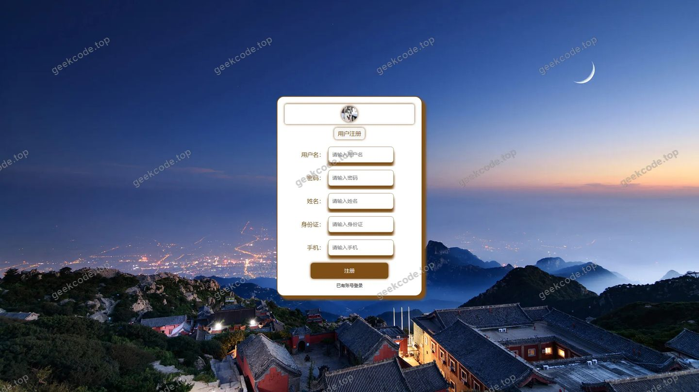</a>

<h4>前台-聚会信息列表</h4>

<a href="https://geekcode.top/archives/%E4%BA%A4%E6%B5%81%E4%BA%92%E5%8A%A8%E7%B3%BB%E7%BB%9F-1?utm_source=github" title="查看完整源码">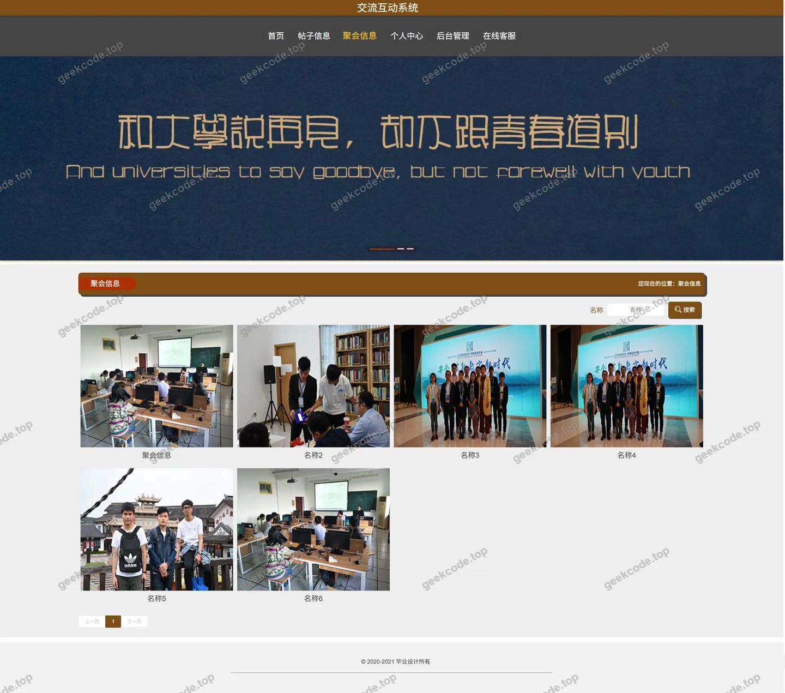</a>

<h4>前台-帖子信息列表</h4>

<a href="https://geekcode.top/archives/%E4%BA%A4%E6%B5%81%E4%BA%92%E5%8A%A8%E7%B3%BB%E7%BB%9F-1?utm_source=github" title="查看完整源码">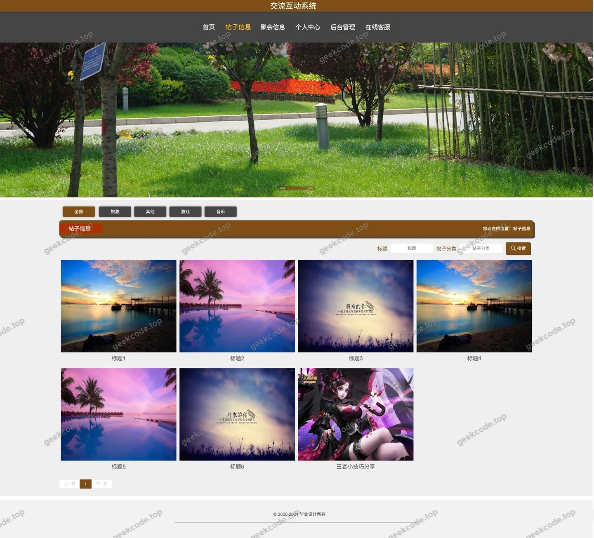</a>

<h4>前台-帖子信息评论列表</h4>

<a href="https://geekcode.top/archives/%E4%BA%A4%E6%B5%81%E4%BA%92%E5%8A%A8%E7%B3%BB%E7%BB%9F-1?utm_source=github" title="查看完整源码">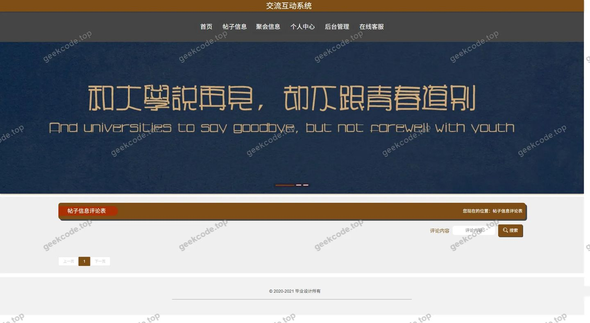</a>

<h4>前台个人中心</h4>

<h4>前台-我的收藏列表</h4>

<a href="https://geekcode.top/archives/%E4%BA%A4%E6%B5%81%E4%BA%92%E5%8A%A8%E7%B3%BB%E7%BB%9F-1?utm_source=github" title="查看完整源码">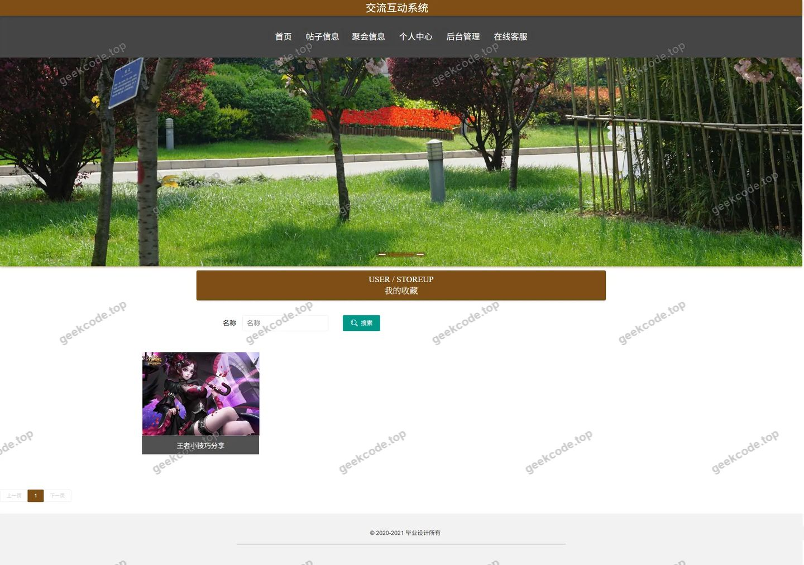</a>

<h4>前台-聚会信息-详情</h4>

<a href="https://geekcode.top/archives/%E4%BA%A4%E6%B5%81%E4%BA%92%E5%8A%A8%E7%B3%BB%E7%BB%9F-1?utm_source=github" title="查看完整源码">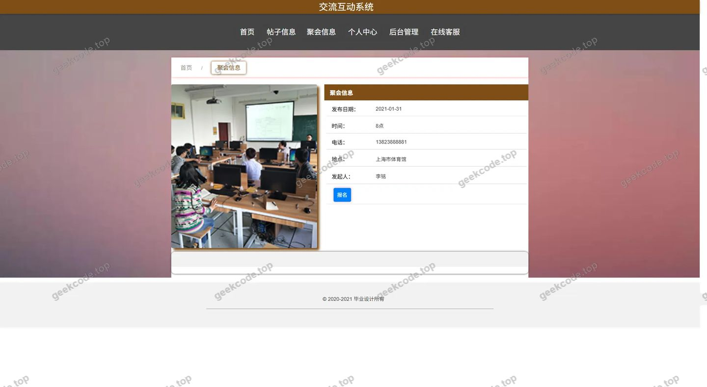</a>

<h4>前台-帖子信息-详情</h4>

<a href="https://geekcode.top/archives/%E4%BA%A4%E6%B5%81%E4%BA%92%E5%8A%A8%E7%B3%BB%E7%BB%9F-1?utm_source=github" title="查看完整源码">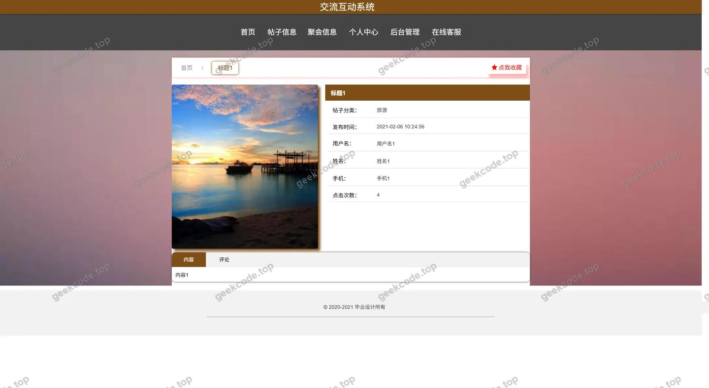</a>

<h4>前台-报名信息列表</h4>

<h4>前台-帖子分类列表</h4>

<a href="https://geekcode.top/archives/%E4%BA%A4%E6%B5%81%E4%BA%92%E5%8A%A8%E7%B3%BB%E7%BB%9F-1?utm_source=github" title="查看完整源码">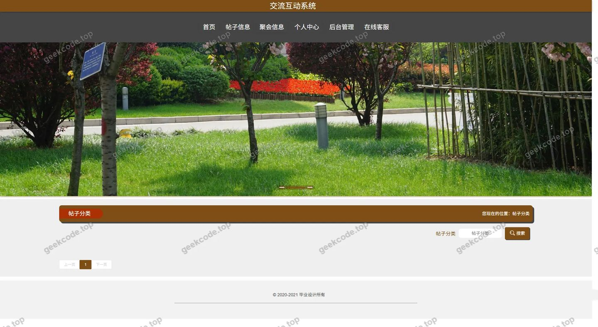</a>

<h4>前台-报名信息-详情</h4>

<h4>前台-帖子信息评论-详情</h4>

<a href="https://geekcode.top/archives/%E4%BA%A4%E6%B5%81%E4%BA%92%E5%8A%A8%E7%B3%BB%E7%BB%9F-1?utm_source=github" title="查看完整源码">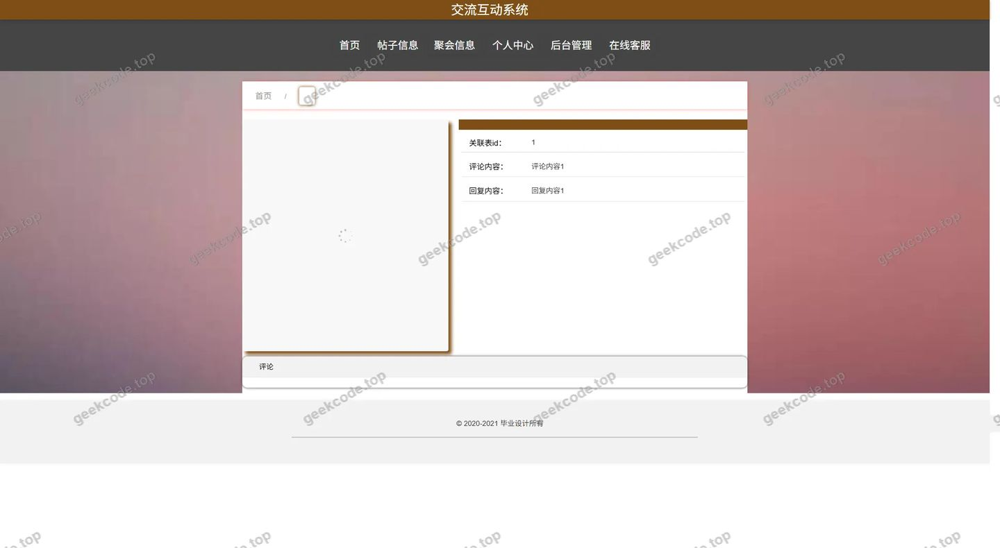</a>

<h4>前台-在线客服</h4>

<a href="https://geekcode.top/archives/%E4%BA%A4%E6%B5%81%E4%BA%92%E5%8A%A8%E7%B3%BB%E7%BB%9F-1?utm_source=github" title="查看完整源码">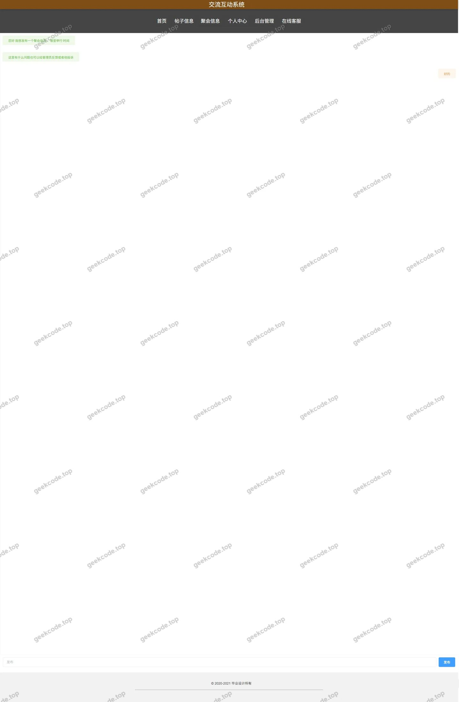</a>

<h3>后台管理端</h3>
<h4>后台-报名信息</h4>

<a href="https://geekcode.top/archives/%E4%BA%A4%E6%B5%81%E4%BA%92%E5%8A%A8%E7%B3%BB%E7%BB%9F-1?utm_source=github" title="查看完整源码">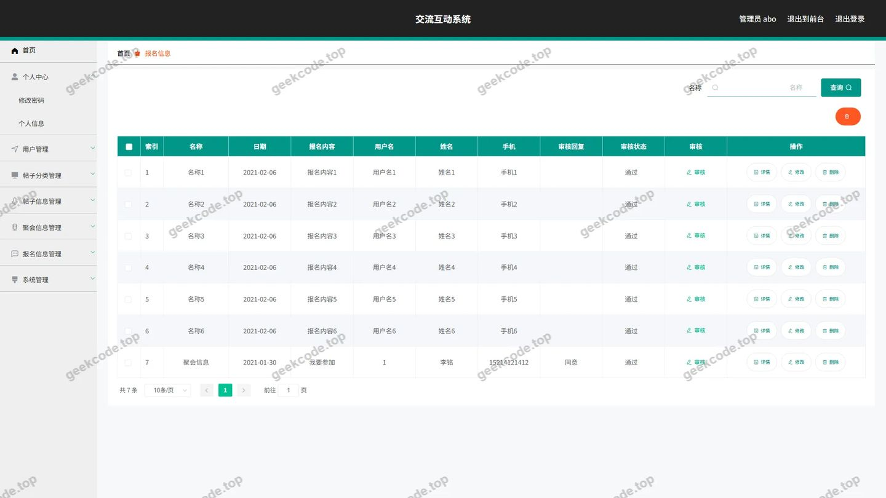</a>

<h4>后台-在线客服</h4>

<a href="https://geekcode.top/archives/%E4%BA%A4%E6%B5%81%E4%BA%92%E5%8A%A8%E7%B3%BB%E7%BB%9F-1?utm_source=github" title="查看完整源码">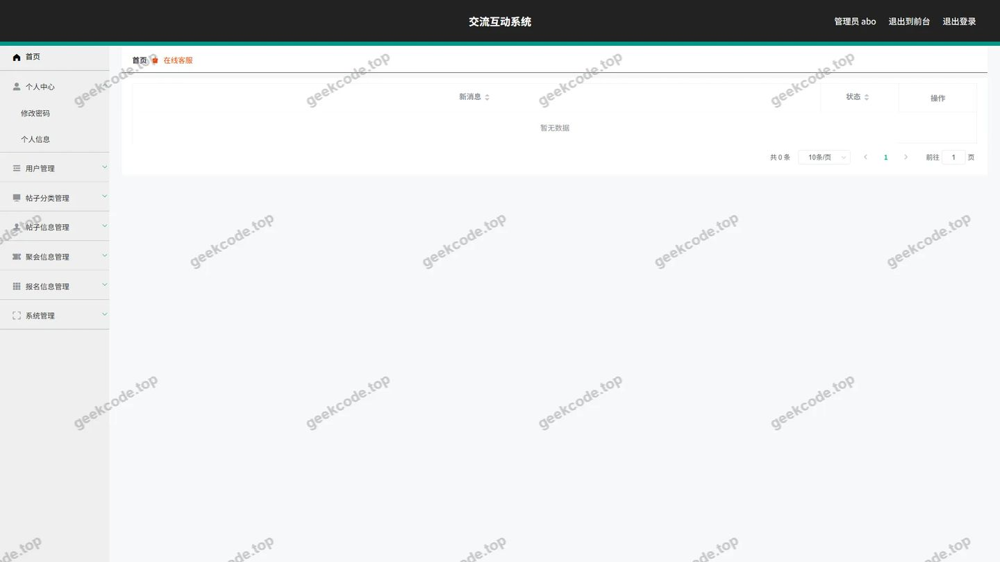</a>

<h4>后台-系统配置</h4>

<a href="https://geekcode.top/archives/%E4%BA%A4%E6%B5%81%E4%BA%92%E5%8A%A8%E7%B3%BB%E7%BB%9F-1?utm_source=github" title="查看完整源码">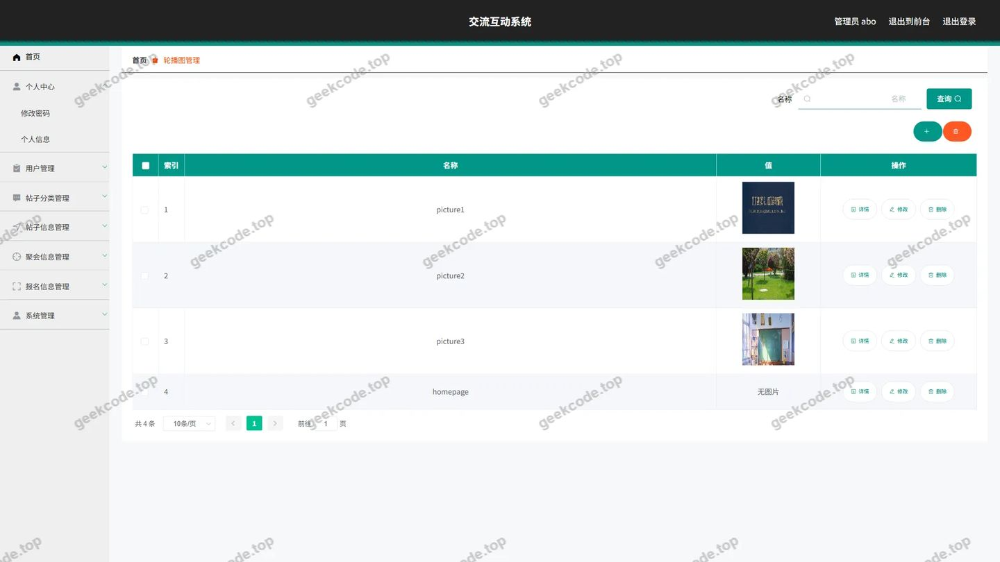</a>

<h4>后台-帖子信息评论</h4>

<a href="https://geekcode.top/archives/%E4%BA%A4%E6%B5%81%E4%BA%92%E5%8A%A8%E7%B3%BB%E7%BB%9F-1?utm_source=github" title="查看完整源码">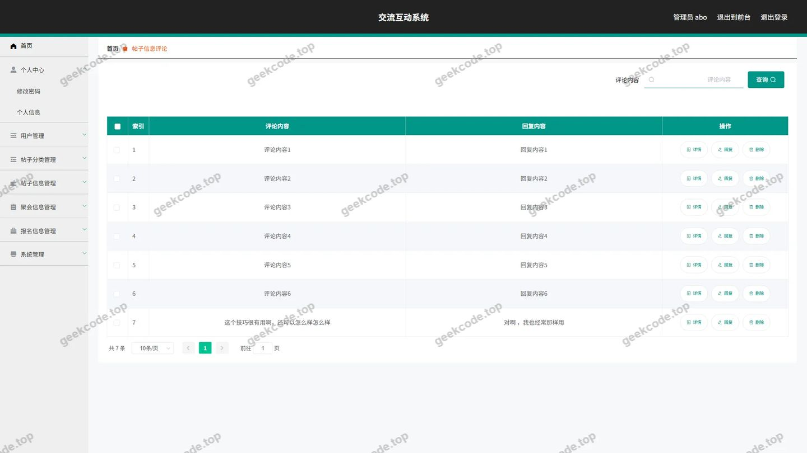</a>

<h4>后台首页</h4>

<a href="https://geekcode.top/archives/%E4%BA%A4%E6%B5%81%E4%BA%92%E5%8A%A8%E7%B3%BB%E7%BB%9F-1?utm_source=github" title="查看完整源码">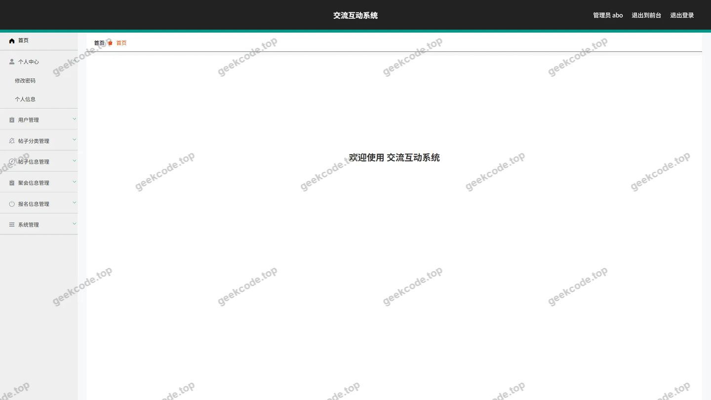</a>

<h4>后台-聚会信息</h4>

<a href="https://geekcode.top/archives/%E4%BA%A4%E6%B5%81%E4%BA%92%E5%8A%A8%E7%B3%BB%E7%BB%9F-1?utm_source=github" title="查看完整源码">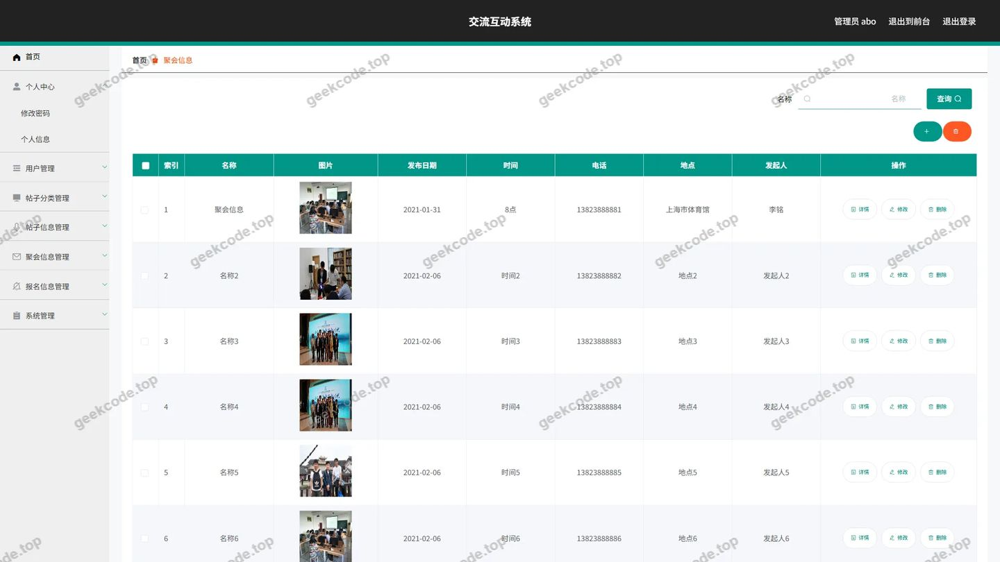</a>

<h4>后台-登录</h4>

<h4>后台-收藏</h4>

<a href="https://geekcode.top/archives/%E4%BA%A4%E6%B5%81%E4%BA%92%E5%8A%A8%E7%B3%BB%E7%BB%9F-1?utm_source=github" title="查看完整源码">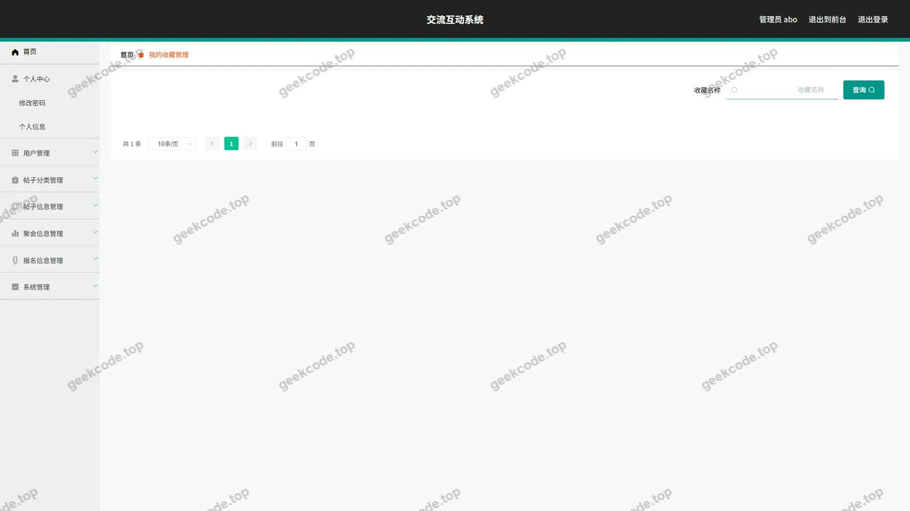</a>

<h4>后台-帖子分类</h4>

<a href="https://geekcode.top/archives/%E4%BA%A4%E6%B5%81%E4%BA%92%E5%8A%A8%E7%B3%BB%E7%BB%9F-1?utm_source=github" title="查看完整源码">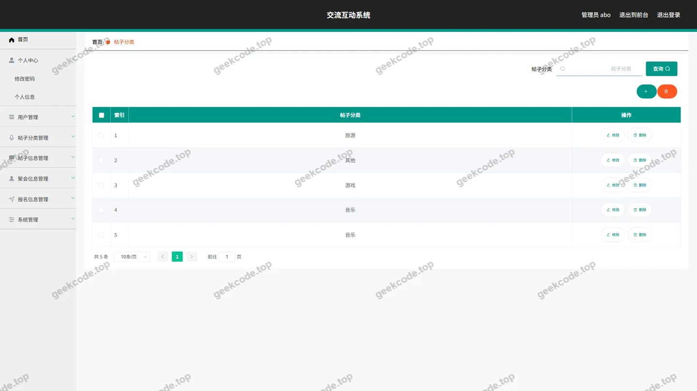</a>

<h4>后台-帖子信息</h4>

<a href="https://geekcode.top/archives/%E4%BA%A4%E6%B5%81%E4%BA%92%E5%8A%A8%E7%B3%BB%E7%BB%9F-1?utm_source=github" title="查看完整源码">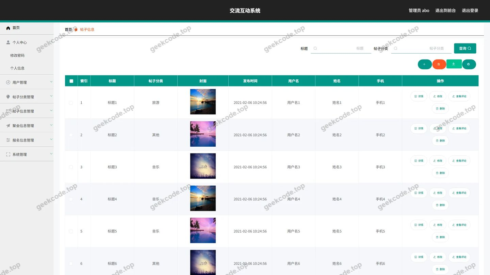</a>

---

## 获取完整源码

| 项目 | 说明 |
| --- | --- |
| 项目名 | 交流互动系统(1) |
| 运行截图 | 本文 25 张（站点带水印原图，仓库 `images/` 目录） |
| 完整源码 | [https://geekcode.top/archives/%E4%BA%A4%E6%B5%81%E4%BA%92%E5%8A%A8%E7%B3%BB%E7%BB%9F-1?utm_source=github](https://geekcode.top/archives/%E4%BA%A4%E6%B5%81%E4%BA%92%E5%8A%A8%E7%B3%BB%E7%BB%9F-1?utm_source=github) |
| 咨询微信 | **ir9372**（备注：jingpin-yuanma） |
| 更多项目 | [极客代码 geekcode.top](https://geekcode.top/?utm_source=github) |

> 需要源码、部署、改配置、跑不起来等问题，加微信 ir9372 沟通，说明项目名即可。
